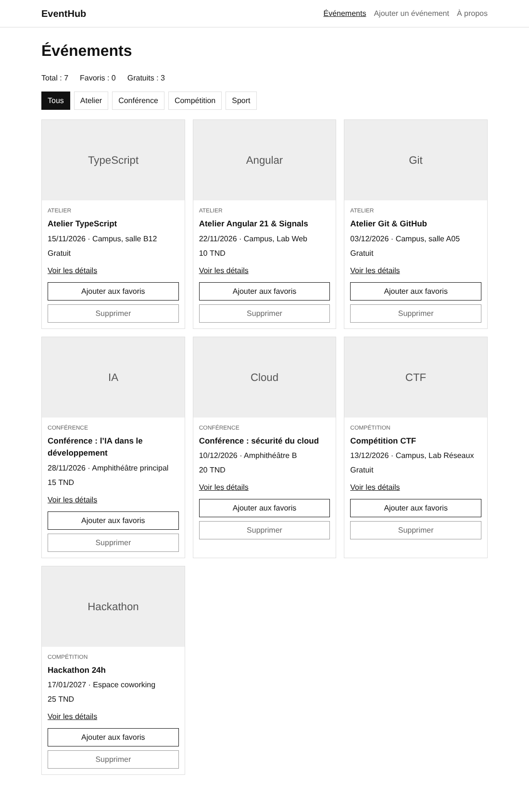
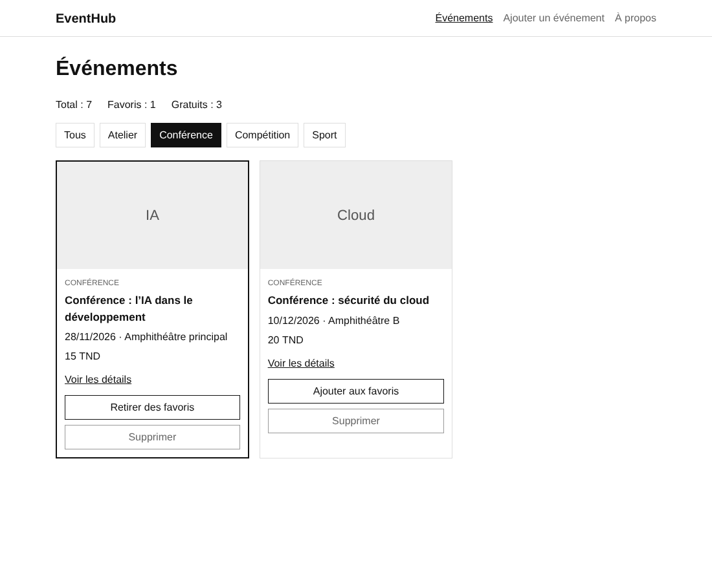
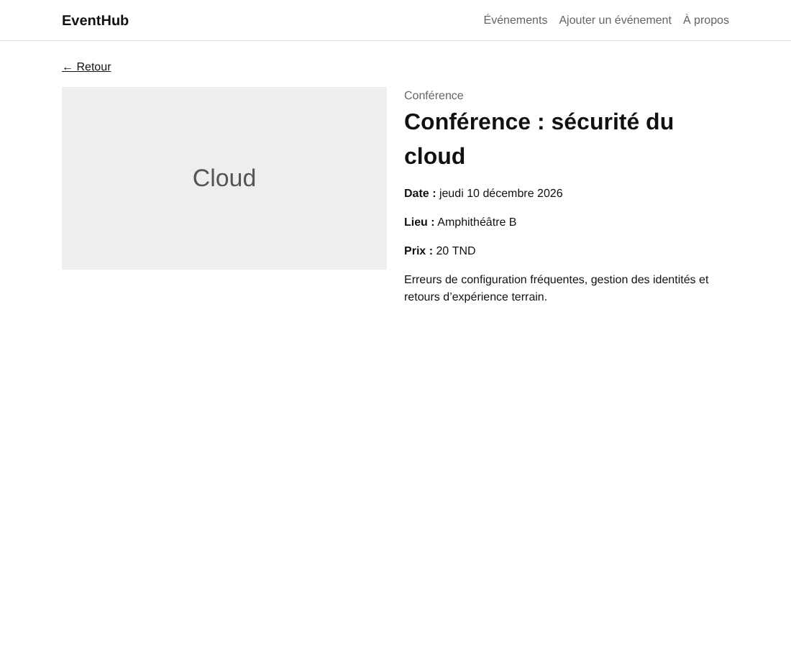
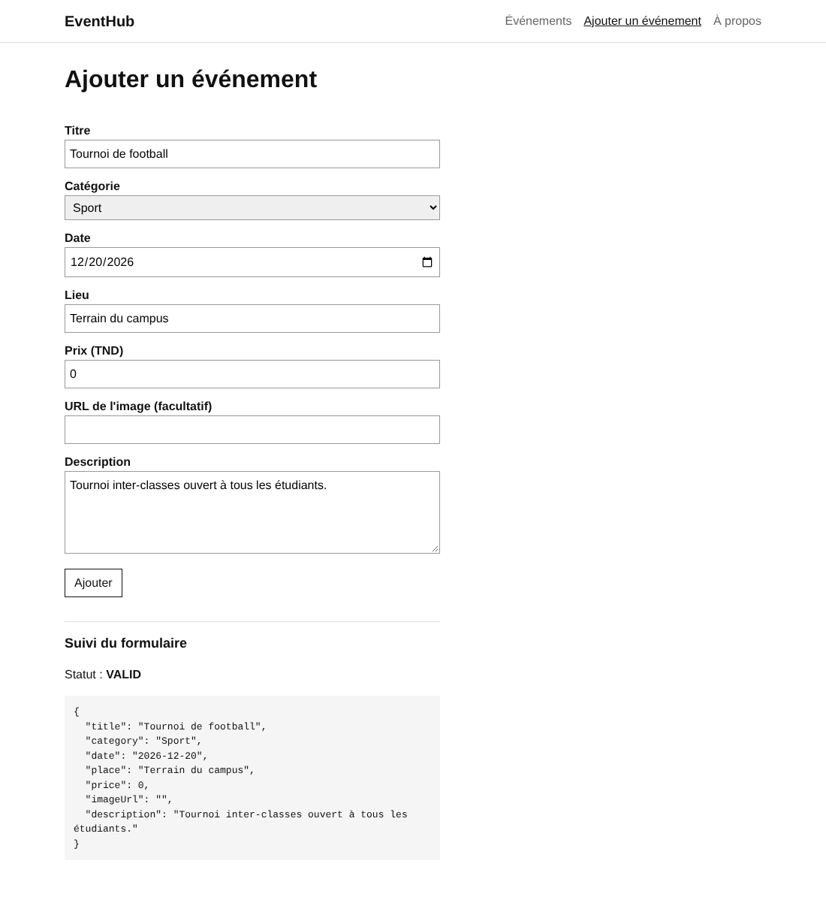
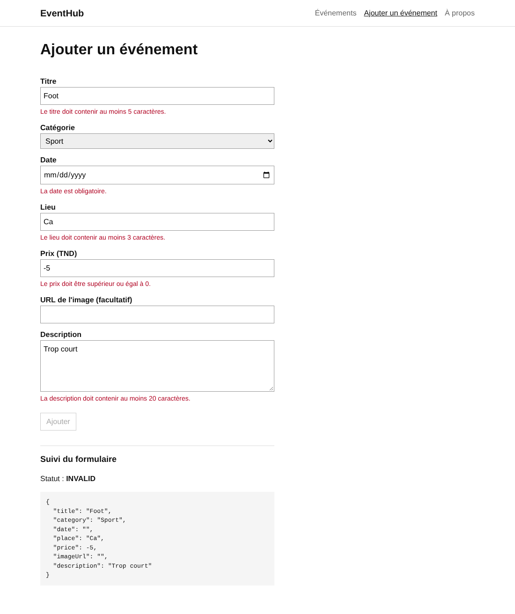
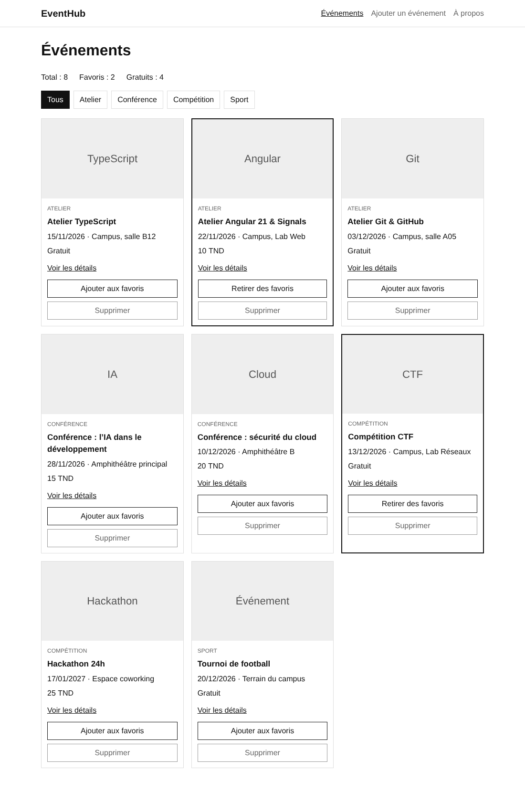
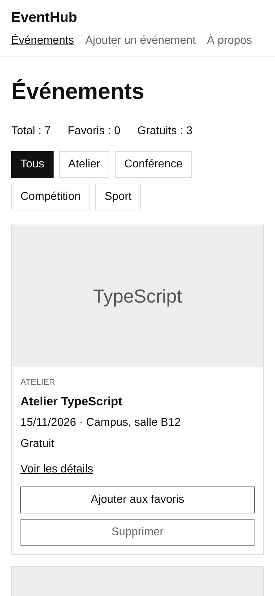

# EventHub – Mini-projet Angular 21

Application Angular standalone qui présente les activités d'une association étudiante
(ateliers, conférences, compétitions). On peut consulter les événements, les filtrer par
catégorie, voir le détail d'un événement, gérer une liste de favoris, ajouter un événement avec un
formulaire et supprimer un événement.

Tout est côté client : les données sont gardées en mémoire dans un service Angular (pas d'API, pas
de base de données). Elles reviennent à l'état initial quand on recharge la page.

- **Partie 1** : composants, Signals, `input()` / `output()`, control flow, pipes, routage.
- **Partie 2** : formulaire réactif avec validations, service `EventService` qui partage les
  données entre les pages avec des Signals.

**Auteur :** Jihed Ramedi

## Versions utilisées

- Angular 21.2
- Angular CLI 21.2
- Node.js 24
- TypeScript 5.9

## Installation et lancement

```bash
git clone https://github.com/JihedR/eventhub-SSA16-ramedi-jihed.git
cd eventhub-SSA16-ramedi-jihed
npm install
ng serve --open
```

L'application s'ouvre sur http://localhost:4200 et redirige vers `/events`.

## Structure

```
src/app/
├── app.ts, app.html           composant racine (Header + router-outlet)
├── app.routes.ts              routes
├── app.config.ts              provideRouter, withComponentInputBinding, locale fr
├── models/event-item.ts       interface EventItem
├── services/
│   └── event.service.ts       les événements, les favoris et les compteurs (Signals)
├── components/
│   ├── header/
│   └── event-card/
└── pages/
    ├── event-list/
    ├── event-details/
    ├── event-form/
    ├── not-found/
    └── about/
```

## Rôle des composants

- **EventService** : source unique des données. Contient les Signals privés `_events` et `_favorites`, les expose en lecture seule et fournit les compteurs et les méthodes de modification.
- **Header** : titre de l'application et menu de navigation (Événements, Ajouter un événement, À propos). `routerLinkActive` souligne la page active.
- **EventList** : page `/events`. Lit les événements et les compteurs depuis le service, garde la catégorie choisie dans un Signal et affiche les cartes avec `@for`.
- **EventCard** : affiche un événement reçu avec `input()` et prévient EventList avec `output()` quand on clique sur « Ajouter aux favoris » ou « Supprimer ».
- **EventForm** : page `/events/add`. Formulaire réactif de création d'un événement.
- **EventDetails** : page `/events/:id`. Récupère l'id de l'URL avec `input()` et demande l'événement au service, ou affiche un message s'il n'existe pas.
- **NotFound** : page affichée pour une URL inconnue (route `**`).
- **About** : page de présentation, chargée en lazy loading avec `loadComponent()`.

## Fonctionnalités

### Partie 1

- Liste des événements avec `@for (...; track event.id)` et `@empty` (« Aucun événement disponible »).
- Pipes `date`, `currency` et `uppercase`.
- Favoris : le bouton de la carte émet un `output()`, EventList demande au service de mettre à jour les favoris. La carte en favori a une bordure noire (`[class.active]`) et le texte du bouton change (`@if / @else`).
- Filtre par catégorie : la catégorie choisie est dans un Signal, la liste affichée est un `computed()`. Au départ la catégorie « Sport » n'a aucun événement, elle sert à tester `@empty`.
- Routes : `/events`, `/events/:id`, `/about`, `**`, et redirection de `''` vers `/events`.
- Lazy loading de `/about` : un fichier JS séparé est chargé à la première visite (visible dans l'onglet Network).
- Mise en page simple et responsive (grille CSS qui passe à une colonne sur téléphone).

### Partie 2

**Formulaire réactif (`EventForm`)**

- `FormGroup` nommé `eventForm`, relié au template avec `[formGroup]` et `formControlName`.

| Champ | Type | Validation |
| --- | --- | --- |
| title | text | `required`, `minLength(5)`, `maxLength(50)` |
| category | select | `required` (Atelier, Conférence ou Sport) |
| date | date | `required` |
| place | text | `required`, `minLength(3)` |
| price | number | `required`, `min(0)` |
| imageUrl | text | facultatif (image par défaut si vide) |
| description | textarea | `required`, `minLength(20)` |

- Un message d'erreur adapté s'affiche sous un champ invalide seulement après qu'il a été touché (`invalid && touched`, puis `hasError()` pour choisir le message).
- Le bouton « Ajouter » est désactivé tant que le formulaire est invalide (`[disabled]="eventForm.invalid"`).
- `formValue` et `formStatus` sont créés avec `toSignal()` à partir de `valueChanges` et `statusChanges`. Ils sont affichés en direct sous le formulaire (JSON et statut VALID / INVALID).
- `addEvent()` vérifie le formulaire, récupère les valeurs, appelle `eventService.addEvent()`, fait `reset()` puis navigue vers `/events`.

**Service et Signals (`EventService`)**

- `@Injectable({ providedIn: 'root' })` : une seule instance pour toute l'application, injectée avec `inject()`.
- Signals privés `_events` et `_favorites`, exposés avec `asReadonly()` : les composants peuvent lire mais pas modifier.
- Compteurs `computed()` affichés dans EventList : `eventCount` (total), `favoriteCount` (favoris), `freeEventCount` (gratuits).
- Méthodes (toutes les modifications passent par `set()` ou `update()`) :

| Méthode | Rôle |
| --- | --- |
| `getEventById(id)` | retrouve un événement par son id |
| `addEvent(event)` | reçoit un événement sans id, lui donne un id unique et l'ajoute |
| `deleteEvent(id)` | supprime l'événement et retire son id des favoris |
| `toggleFavorite(id)` | ajoute ou retire l'id des favoris |

- Bouton « Supprimer » sur chaque carte : la carte émet `deleteClicked`, EventList demande une confirmation (`confirm()`) puis appelle le service. La liste et les compteurs se mettent à jour tout seuls.
- Route `/events/add` déclarée avant `/events/:id` et lien « Ajouter un événement » dans le menu.

## Choix techniques

- Les événements sont dans `EventService` : EventList, EventDetails et EventForm utilisent la même instance, donc un ajout ou une suppression se voit partout immédiatement. Les favoris sont aussi dans le service, ils ne sont plus perdus quand on change de page.
- Signals privés + `asReadonly()` : seul le service peut modifier les données, les composants passent par ses méthodes.
- L'id est généré dans le service avec un compteur `nextId` qui ne redescend jamais : un événement ajouté après une suppression ne reprend pas l'id de l'événement supprimé.
- `deleteEvent()` retire aussi l'id des favoris, sinon `favoriteCount` compterait un événement qui n'existe plus.
- Les contrôles du formulaire sont `nonNullable` : `reset()` remet les valeurs de départ (`''`, `0`) au lieu de `null`, et les types restent `string` / `number`.
- Le type reste `EventItem` (et pas `Event`) pour ne pas le confondre avec le type `Event` du DOM.
- Les favoris sont stockés sous forme d'ids : plus simple à comparer et pas de doublons.
- `update()` retourne un nouveau tableau (`[...list, id]`, `filter`) : si on modifie le tableau avec `push`, le Signal ne détecte pas le changement.
- EventCard ne modifie ni les favoris ni la liste elle-même : elle prévient le parent avec `output()`, qui appelle le service.
- `input()` avec `withComponentInputBinding()` au lieu d'ActivatedRoute : moins de code et l'id est directement un Signal.
- La route `**` est en dernier et `/events/add` est avant `/events/:id`, car le routeur prend la première route qui correspond.

## Tests

### Tests unitaires

`ng test` lance les tests de `App` et de `EventService` (compteurs, ajout, id unique après
suppression, favoris après suppression).

### Tests manuels : Partie 1

| Cas | Résultat attendu | OK |
| --- | --- | --- |
| Affichage initial | `/` redirige vers `/events`, 7 événements | ✅ |
| Filtre | « Atelier » affiche 3 événements | ✅ |
| Liste vide | « Sport » affiche « Aucun événement disponible » | ✅ |
| Favoris | ajout et retrait mettent à jour le compteur et la carte | ✅ |
| Détail | « Voir les détails » ouvre `/events/2` | ✅ |
| Id inexistant | `/events/999` affiche « Événement introuvable » | ✅ |
| Lien actif | le lien de la page courante est souligné | ✅ |
| URL inconnue | `/xyz` affiche la page 404 | ✅ |
| /about | un chunk JS est chargé à la première visite | ✅ |

### Tests manuels : Partie 2

| Cas | Résultat attendu | OK |
| --- | --- | --- |
| Formulaire vide | bouton « Ajouter » désactivé, statut INVALID, pas d'erreur avant d'avoir touché un champ | ✅ |
| Champs touchés vides | « Le titre est obligatoire. », « Le lieu est obligatoire. »… | ✅ |
| Titre trop court | « Foot » affiche « au moins 5 caractères » | ✅ |
| Prix négatif | « -5 » affiche « supérieur ou égal à 0 » | ✅ |
| Événement valide | statut VALID, JSON à jour en direct, bouton actif | ✅ |
| Ajout | retour sur `/events`, le nouvel événement apparaît tout de suite (id 8) | ✅ |
| Compteurs | après l'ajout d'un événement gratuit : Total 7 → 8, Gratuits 3 → 4 | ✅ |
| Formulaire après ajout | les champs sont vides quand on revient sur `/events/add` | ✅ |
| Suppression annulée | « Annuler » dans la confirmation : rien ne change | ✅ |
| Suppression | l'événement disparaît, Total diminue | ✅ |
| Favoris après suppression | supprimer un favori fait baisser « Favoris » | ✅ |
| Navigation | les favoris restent après un passage par une autre page | ✅ |
| `/events/add` | affiche le formulaire, pas « Événement introuvable » | ✅ |

## Captures d'écran

Liste des événements :



Filtre « Conférence » avec un favori :



Détail d'un événement :



Formulaire valide avec le suivi en direct (Partie 2) :



Messages d'erreur du formulaire :



Liste avec les trois compteurs, deux favoris et l'événement ajouté :



Sur téléphone :


