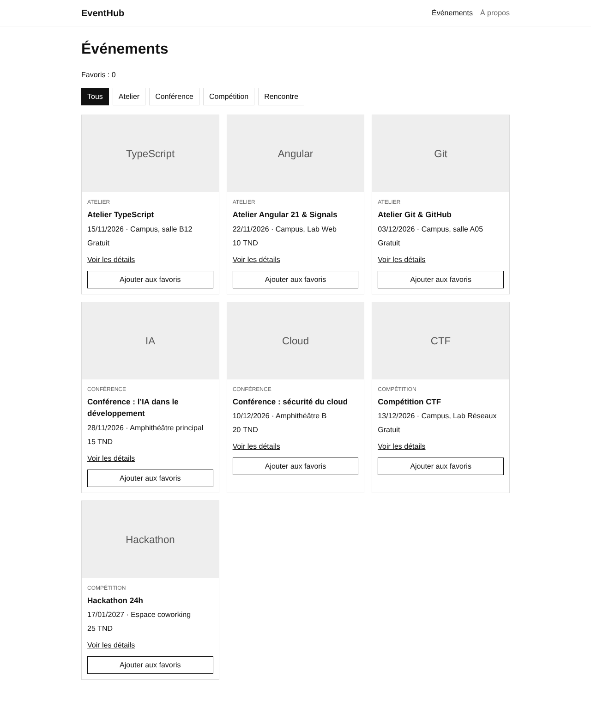
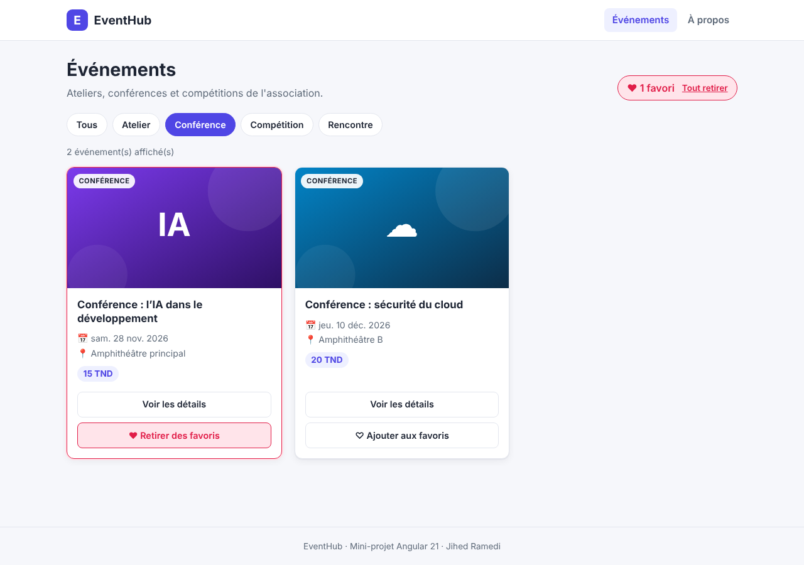
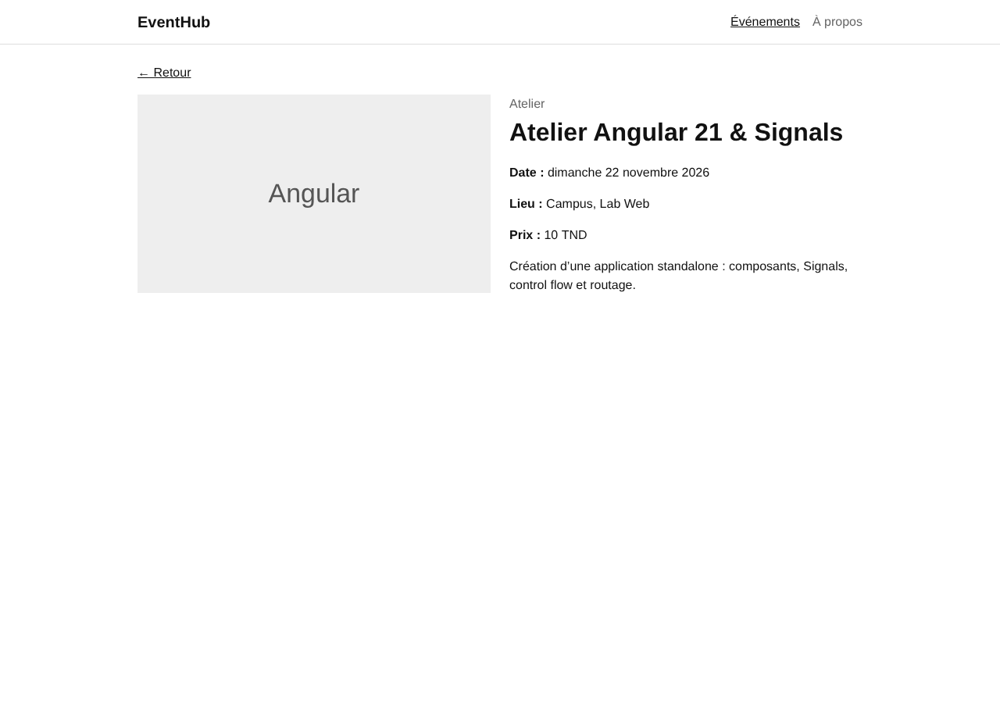
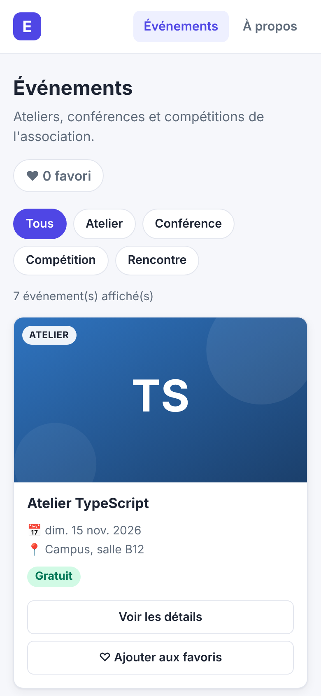

# EventHub – Mini-projet Angular 21

Application Angular standalone qui présente les activités d'une association étudiante
(ateliers, conférences, compétitions). On peut consulter les événements, les filtrer par
catégorie, voir le détail d'un événement et gérer une liste de favoris.

Tout est côté client : les données sont dans un tableau TypeScript (pas d'API, pas de base de
données).

**Auteur :** Jihed Ramedi

## Versions utilisées

- Angular 21.2
- Angular CLI 21.2
- Node.js 24
- TypeScript 5.9

## Installation et lancement

```bash
git clone https://github.com/JihedR/eventhub-SSA16-ramedi-jihed.git
cd eventhub-SSA16-ramedi-jihed
npm install
ng serve --open
```

L'application s'ouvre sur http://localhost:4200 et redirige vers `/events`.

## Structure

```
src/app/
├── app.ts, app.html           composant racine (Header + router-outlet)
├── app.routes.ts              routes
├── app.config.ts              provideRouter, withComponentInputBinding, locale fr
├── models/event-item.ts       interface EventItem
├── data/events.data.ts        les 7 événements
├── components/
│   ├── header/
│   └── event-card/
└── pages/
    ├── event-list/
    ├── event-details/
    ├── not-found/
    └── about/
```

## Rôle des composants

- **Header** : titre de l'application et menu de navigation. `routerLinkActive` souligne la page active.
- **EventList** : page `/events`. Contient les Signals (événements, favoris, catégorie choisie) et affiche les cartes avec `@for`.
- **EventCard** : affiche un événement reçu avec `input()` et prévient EventList avec `output()` quand on clique sur le bouton favori.
- **EventDetails** : page `/events/:id`. Récupère l'id de l'URL avec `input()` et affiche l'événement, ou un message s'il n'existe pas.
- **NotFound** : page affichée pour une URL inconnue (route `**`).
- **About** : page de présentation, chargée en lazy loading avec `loadComponent()`.

## Fonctionnalités

- Liste des événements avec `@for (...; track event.id)` et `@empty` (« Aucun événement disponible »).
- Pipes `date`, `currency` et `uppercase`.
- Favoris : le bouton de la carte émet un `output()`, EventList met à jour le Signal `favorites` avec `update()`. Le compteur est un `computed()`. La carte en favori a une bordure noire (`[class.active]`) et le texte du bouton change (`@if / @else`).
- Filtre par catégorie : la catégorie choisie est dans un Signal, la liste affichée est un `computed()`. La catégorie « Rencontre » n'a pas encore d'événement, elle sert à tester `@empty`.
- Routes : `/events`, `/events/:id`, `/about`, `**`, et redirection de `''` vers `/events`.
- Lazy loading de `/about` : un fichier JS séparé est chargé à la première visite (visible dans l'onglet Network).
- Mise en page simple et responsive (grille CSS qui passe à une colonne sur téléphone).

## Choix techniques

- Les événements sont dans `data/events.data.ts` car EventList et EventDetails en ont besoin tous les deux.
- Les favoris sont stockés sous forme d'ids : plus simple à comparer et pas de doublons.
- `update()` retourne un nouveau tableau (`[...list, id]`, `filter`) : si on modifie le tableau avec `push`, le Signal ne détecte pas le changement.
- EventCard ne modifie pas les favoris elle-même : elle prévient le parent, qui reste le seul à changer l'état.
- `input()` avec `withComponentInputBinding()` au lieu d'ActivatedRoute : moins de code et l'id est directement un Signal.
- La route `**` est en dernier car le routeur prend la première route qui correspond.

## Tests manuels

| Cas | Résultat attendu | OK |
| --- | --- | --- |
| Affichage initial | `/` redirige vers `/events`, 7 événements | ✅ |
| Filtre | « Atelier » affiche 3 événements | ✅ |
| Liste vide | « Rencontre » affiche « Aucun événement disponible » | ✅ |
| Favoris | ajout et retrait mettent à jour le compteur et la carte | ✅ |
| Détail | « Voir les détails » ouvre `/events/2` | ✅ |
| Id inexistant | `/events/999` affiche « Événement introuvable » | ✅ |
| Lien actif | le lien de la page courante est souligné | ✅ |
| URL inconnue | `/xyz` affiche la page 404 | ✅ |
| /about | un chunk JS est chargé à la première visite | ✅ |

## Captures d'écran

Liste des événements :



Filtre « Conférence » avec un favori :



Détail d'un événement :



Sur téléphone :


